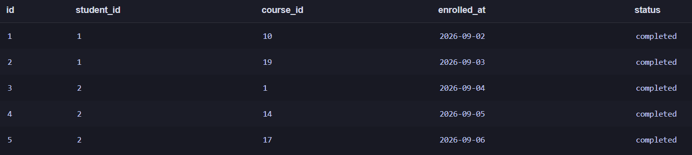

# Лабораторная работа №4 — анализ учебного набора данных с помощью SQL

**Модуль:** Данные и технологии хранения информации  
**Тема:** Технологии хранения и обработки данных  
**Вариант:** 5  
**СУБД:** SQLite  
**Файл базы данных:** `dataset.sqlite`

> **Методика.** Анализ выполнен на учебной базе `dataset.sqlite` в SQLite. Для проверки использованы контрольные количества записей, проверка связей таблиц и повторный запрос для подтверждения максимального разброса оценок.

## 1. Загрузка базы и первичная проверка

В базе данных находятся шесть таблиц: `groups`, `students`, `teachers`, `courses`, `enrollments` и `results`. Для первичной проверки посчитано количество записей в каждой таблице.

**SQL-запрос:**

```sql
SELECT 'groups' AS table_name, COUNT(*) AS rows_count FROM groups
UNION ALL
SELECT 'students', COUNT(*) FROM students
UNION ALL
SELECT 'teachers', COUNT(*) FROM teachers
UNION ALL
SELECT 'courses', COUNT(*) FROM courses
UNION ALL
SELECT 'enrollments', COUNT(*) FROM enrollments
UNION ALL
SELECT 'results', COUNT(*) FROM results
ORDER BY table_name;
```

**Полученный результат:**

| Таблица | Получено записей | Контрольное значение | Проверка |
|---|---:|---:|---|
| `groups` | 12 | 12 | Совпадает |
| `students` | 240 | 240 | Совпадает |
| `teachers` | 15 | 15 | Совпадает |
| `courses` | 30 | 30 | Совпадает |
| `enrollments` | 1000 | 1000 | Совпадает |
| `results` | 850 | 850 | Совпадает |

Все шесть значений совпали с контрольными значениями из задания. Следовательно, используется нужная учебная база данных.

**Скриншот для отчёта:** `../images/step01_counts.png` — результат запроса с шестью количествами.

## 2. Изучение структуры и формулирование аналитических вопросов

### 2.1. Назначение таблиц

| Таблица | Назначение | Основные поля |
|---|---|---|
| `groups` | Учебные группы | `id`, `group_name`, `study_year` |
| `students` | Студенты | `id`, `full_name`, `group_id`, `admission_year` |
| `teachers` | Преподаватели | `id`, `full_name`, `department` |
| `courses` | Курсы | `id`, `course_name`, `hours`, `teacher_id` |
| `enrollments` | Записи студентов на курсы | `id`, `student_id`, `course_id`, `enrolled_at`, `status` |
| `results` | Итоговые оценки | `id`, `enrollment_id`, `score`, `completed_at` |

### 2.2. Первичные и внешние ключи

По результатам просмотра структуры таблиц (`PRAGMA table_info`) поле `id` является первичным ключом во всех шести таблицах. Внешние ключи, обнаруженные с помощью `PRAGMA foreign_key_list`, следующие:

| Таблица | Поле внешнего ключа | Связанная таблица и поле |
|---|---|---|
| `students` | `group_id` | `groups.id` |
| `courses` | `teacher_id` | `teachers.id` |
| `enrollments` | `student_id` | `students.id` |
| `enrollments` | `course_id` | `courses.id` |
| `results` | `enrollment_id` | `enrollments.id` |

Таблица `enrollments` связывает студентов и курсы: по `student_id` можно определить студента, а по `course_id` — выбранный им курс. Таблица `results` связана с конкретной записью на курс через `enrollment_id`. Поэтому при анализе оценок путь соединения выглядит так: `courses → enrollments → results`.

**Запросы для просмотра структуры:**

```sql
PRAGMA table_info(enrollments);
PRAGMA foreign_key_list(enrollments);
PRAGMA table_info(results);
PRAGMA foreign_key_list(results);
```

**Фактическое наблюдение:** `enrollments` имеет первичный ключ `id` и два внешних ключа — `student_id` и `course_id`. Таблица `results` имеет первичный ключ `id` и внешний ключ `enrollment_id`. Во всех таблицах поле `id` имеет тип `INTEGER`; текстовые поля имеют тип `TEXT`.

**Скриншот:** результат `PRAGMA table_info(enrollments)` приведён в подразделе 2.4. Внешние ключи дополнительно проверяются командами `PRAGMA foreign_key_list` и `PRAGMA foreign_key_check`.

### 2.3. Аналитические вопросы

1. Какие курсы отличаются наибольшим разбросом оценок? (`courses`, `enrollments`, `results`; показатель — `MAX(score) - MIN(score)`). **Индивидуальный вопрос варианта 5.**
2. Какие курсы имеют самую высокую среднюю оценку? (`courses`, `enrollments`, `results`; показатель — `AVG(score)`).
3. Как распределяются записи на курсы по статусам? (`enrollments`; показатель — количество записей по каждому `status`).
4. Сколько курсов закреплено за каждым преподавателем? (`teachers`, `courses`; показатель — количество курсов).
5. Сколько студентов учится в каждой группе? (`groups`, `students`; показатель — количество студентов).
6. На каких курсах больше всего итоговых оценок? (`courses`, `enrollments`, `results`; показатель — количество оценок).
7. Есть ли курсы, на которые никто не записывался? (`courses`, `enrollments`; показатель — количество записей на курс).

### 2.4. Просмотр первых строк таблиц

Для ознакомления с содержимым таблиц использованы запросы:

```sql
SELECT * FROM groups LIMIT 5;
SELECT * FROM students LIMIT 5;
SELECT * FROM teachers LIMIT 5;
SELECT * FROM courses LIMIT 5;
SELECT * FROM enrollments LIMIT 5;
SELECT * FROM results LIMIT 5;
```

Первые строки подтверждают, что таблицы содержат данные об учебных группах, студентах, преподавателях, курсах, записях на курсы и итоговых результатах. Например, в `groups` используется поле `group_name` (в выборке встречаются группы `ИВТ-01`, `ИВТ-02` и другие), а в `courses` — название курса, количество часов и идентификатор преподавателя.

**Скриншот 1. Первые пять строк таблицы `enrollments`:**



*Рисунок 1 — просмотр первых пяти записей таблицы `enrollments`.*

**Скриншот 2. Структура таблицы `enrollments`:**


*Рисунок 2 — результат выполнения `PRAGMA table_info(enrollments)`.*

Для остальных таблиц первые строки просматриваются аналогичными запросами `SELECT * FROM имя_таблицы LIMIT 5`.

## 3. Фильтрация и сортировка

### 3.1. Курсы продолжительностью не менее 60 часов

**Цель:** отобрать курсы продолжительностью от 60 часов и отсортировать их по убыванию часов.

```sql
SELECT id, course_name, hours
FROM courses
WHERE hours >= 60
ORDER BY hours DESC, course_name ASC;
```

**Полученный результат:** найдено **15 курсов**. Максимальная продолжительность среди них — **84 часа**. По 84 часа имеют «Компьютерные сети», «Мобильная разработка», «Облачные технологии», «Проектный практикум» и «Разработка API». Далее в отсортированном списке идут курсы продолжительностью 72 и 60 часов.

**Объяснение:** `WHERE hours >= 60` оставляет только курсы, удовлетворяющие условию, а `ORDER BY hours DESC, course_name ASC` сначала сортирует их по часам от большего к меньшему, а при одинаковом количестве часов — по названию.

**Скриншот для отчёта:** `../images/step03_courses.png`.

### 3.2. Студенты, поступившие в 2025 году

**Цель:** вывести первые десять студентов, поступивших в 2025 году, в алфавитном порядке.

```sql
SELECT id, full_name, admission_year
FROM students
WHERE admission_year = 2025
ORDER BY full_name ASC
LIMIT 10;
```

**Полученный результат:** в базе найдено **60 студентов**, поступивших в 2025 году. По условию `LIMIT 10` запрос выводит первые 10 строк. В этом выводе присутствуют фамилии Васильев и Иванов.

**Объяснение:** `WHERE` отбирает студентов по году поступления, `ORDER BY` сортирует их по полю `full_name`, а `LIMIT 10` ограничивает результат десятью строками.

**Скриншот для отчёта:** `../images/step03_students.png`.

## 4. Агрегирование и группировка

### 4.1. Общее количество записей на курсы

```sql
SELECT COUNT(*) AS total_enrollments
FROM enrollments;
```

**Полученный результат:** **1000 записей**. Значение совпадает с контрольным количеством из задания.

**Скриншот для отчёта:** `../images/step04_count.png`.

### 4.2. Минимальная, максимальная, средняя и суммарная продолжительность курсов

```sql
SELECT
    MIN(hours) AS min_hours,
    MAX(hours) AS max_hours,
    ROUND(AVG(hours), 2) AS avg_hours,
    SUM(hours) AS total_hours
FROM courses;
```

**Полученный результат:**

| Показатель | Значение |
|---|---:|
| Минимальная продолжительность (`MIN`) | 24 часа |
| Максимальная продолжительность (`MAX`) | 84 часа |
| Средняя продолжительность (`AVG`) | 54 часа |
| Суммарная продолжительность (`SUM`) | 1620 часов |

**Объяснение:** `MIN` возвращает наименьшее значение `hours`, `MAX` — наибольшее, `AVG` — среднее арифметическое, а `SUM` складывает продолжительность всех 30 курсов.

**Скриншот для отчёта:** `../images/step04_aggregates.png`.

### 4.3. Количество записей по статусам и условие HAVING

Для группировки и фильтрации групп использован запрос:

```sql
SELECT status, COUNT(*) AS total
FROM enrollments
GROUP BY status
HAVING COUNT(*) > 100
ORDER BY total DESC;
```

**Полученный результат запроса с `HAVING`:**

| Статус | Количество |
|---|---:|
| `completed` | 850 |

Для проверки полного распределения без фильтра `HAVING` выполнен запрос:

```sql
SELECT status, COUNT(*) AS total
FROM enrollments
GROUP BY status
ORDER BY total DESC;
```

Полное распределение:

| Статус | Количество |
|---|---:|
| `completed` | 850 |
| `active` | 100 |
| `cancelled` | 50 |
| **Итого** | **1000** |

**Объяснение:** `GROUP BY` объединяет записи с одинаковым статусом, а `COUNT(*)` считает строки в каждой группе. `HAVING COUNT(*) > 100` оставляет только группы, в которых более 100 записей. Поэтому в результате остаётся только `completed` с 850 записями. `WHERE` фильтрует отдельные строки до группировки, а `HAVING` — уже сформированные группы после вычисления агрегатных показателей.

**Скриншоты для отчёта:** `../images/step04_having.png` — запрос с `HAVING`; `../images/step04_status_all.png` — полное распределение статусов.

## 5. Соединение таблиц

### 5.1. Студенты и их учебные группы (`INNER JOIN`)

```sql
SELECT s.id, s.full_name, g.group_name
FROM students AS s
INNER JOIN groups AS g ON g.id = s.group_id
ORDER BY s.id
LIMIT 10;
```

**Полученный результат:** выведено 10 студентов. Например, студент с `id = 1` — Иванов Александр — относится к группе `ИВТ-01`, студент с `id = 2` — Иванов Мария — к группе `ИВТ-02`.

**Объяснение:** `INNER JOIN` соединяет строки студентов и групп по условию `g.id = s.group_id`. В результат попадают только студенты, для которых найдена соответствующая группа.

**Скриншот для отчёта:** `../images/step05_students_groups.png`.

### 5.2. Курсы и назначенные преподаватели (`INNER JOIN`)

```sql
SELECT c.id, c.course_name, t.full_name AS teacher_name
FROM courses AS c
INNER JOIN teachers AS t ON t.id = c.teacher_id
ORDER BY c.id
LIMIT 10;
```

**Полученный результат:** выведено 10 курсов с назначенными преподавателями. Например, курс «Основы программирования» ведёт «Преподаватель 01», а курс «Базы данных» — «Преподаватель 02».

**Объяснение:** таблицы `courses` и `teachers` соединены по `courses.teacher_id = teachers.id`. `INNER JOIN` возвращает только курсы с найденной записью преподавателя.

**Скриншот для отчёта:** `../images/step05_courses_teachers.png`.

### 5.3. Все преподаватели и их курсы (`LEFT JOIN`)

```sql
SELECT t.id, t.full_name AS teacher_name, c.course_name
FROM teachers AS t
LEFT JOIN courses AS c ON c.teacher_id = t.id
ORDER BY t.id, c.id;
```

**Полученный результат:** запрос вернул **30 строк**. В базе 15 преподавателей, и за каждым закреплено по 2 курса. Поэтому каждый преподаватель появляется в результате два раза — по одной строке на каждый курс.

**Объяснение:** `LEFT JOIN` сохраняет все строки левой таблицы `teachers`, даже если справа не найден соответствующий курс. Если курса нет, поля курса были бы равны `NULL`. Число строк может превышать 15, так как одному преподавателю может соответствовать несколько курсов. В этой базе у каждого из 15 преподавателей обнаружено по два курса.

**Скриншот для отчёта:** `../images/step05_teachers_courses.png`.

## 6. Проверка корректности

### 6.1. Проверка значений оценок

```sql
SELECT COUNT(*) AS invalid_scores
FROM results
WHERE score < 0 OR score > 100 OR score IS NULL;
```

**Полученный результат:** `invalid_scores = 0`. Все 850 записей в `results` содержат оценки в допустимом диапазоне от 0 до 100; пропусков `NULL` и оценок за пределами диапазона не обнаружено.

**Скриншот для отчёта:** `../images/step06_invalid_scores.png`.

### 6.2. Проверка связей результатов с записями на курсы

```sql
SELECT COUNT(*) AS orphan_results
FROM results AS r
LEFT JOIN enrollments AS e ON e.id = r.enrollment_id
WHERE e.id IS NULL;
```

**Полученный результат:** `orphan_results = 0`. Все записи из `results` имеют соответствующую запись в `enrollments`.

Дополнительно проверены внешние ключи командой:

```sql
PRAGMA foreign_key_check;
```

Запрос не вернул строк, то есть нарушений внешних ключей не обнаружено.

**Скриншот для отчёта:** `../images/step06_orphan_results.png` (при желании отдельно сохранить результат `PRAGMA foreign_key_check` как `step06_foreign_key_check.png`).

### 6.3. Сводная таблица проверок

| Проверка | Ожидаемое значение | Полученное значение | Итог |
|---|---:|---:|---|
| Количество `groups` | 12 | 12 | Пройдена |
| Количество `students` | 240 | 240 | Пройдена |
| Количество `teachers` | 15 | 15 | Пройдена |
| Количество `courses` | 30 | 30 | Пройдена |
| Количество `enrollments` | 1000 | 1000 | Пройдена |
| Количество `results` | 850 | 850 | Пройдена |
| Недопустимые или пустые оценки | 0 | 0 | Пройдена |
| Результаты без записи на курс | 0 | 0 | Пройдена |
| Нарушения внешних ключей | 0 | 0 | Пройдена |

## 7. Индивидуальное исследование — вариант 5

### 7.1. Вопрос и методика

**Вопрос варианта 5:** «Какие курсы отличаются наибольшим разбросом оценок (`MAX(score) − MIN(score)`)?»

Для ответа нужны таблицы `courses`, `enrollments` и `results`. Они соединяются по ключам `courses.id = enrollments.course_id` и `enrollments.id = results.enrollment_id`. Для каждого курса рассчитываются:

- `COUNT(r.score)` — количество итоговых оценок;
- `MIN(r.score)` — минимальная оценка;
- `MAX(r.score)` — максимальная оценка;
- `MAX(r.score) - MIN(r.score)` — разброс оценок;
- `AVG(r.score)` — средняя оценка для дополнительной интерпретации.

### 7.2. Основной аналитический запрос

```sql
SELECT
    c.id AS course_id,
    c.course_name,
    COUNT(r.score) AS results_count,
    MIN(r.score) AS min_score,
    MAX(r.score) AS max_score,
    MAX(r.score) - MIN(r.score) AS score_range,
    ROUND(AVG(r.score), 2) AS avg_score
FROM courses AS c
INNER JOIN enrollments AS e ON e.course_id = c.id
INNER JOIN results AS r ON r.enrollment_id = e.id
GROUP BY c.id, c.course_name
ORDER BY score_range DESC, results_count DESC, c.course_name ASC;
```

**Результаты:** запрос вернул 28 курсов, у которых есть итоговые оценки. Первые строки ранжированного результата:

| Место | Курс | Количество оценок | Минимум | Максимум | Разброс | Средняя оценка |
|---:|---|---:|---:|---:|---:|---:|
| 1 | Математический анализ | 35 | 30 | 100 | **70** | 74,74 |
| 2 | Инженерия требований | 23 | 33 | 100 | 67 | 77,57 |
| 3 | Основы программирования | 34 | 41 | 100 | 59 | 76,56 |
| 4 | Алгоритмы | 31 | 40 | 99 | 59 | 78,90 |
| 5 | Веб-разработка | 37 | 42 | 100 | 58 | 77,05 |
| 6 | Мобильная разработка | 30 | 42 | 100 | 58 | 75,40 |
| 7 | DevOps | 28 | 42 | 100 | 58 | 78,43 |
| 8 | Архитектура ПО | 26 | 42 | 100 | 58 | 76,15 |
| 9 | Операционные системы | 37 | 43 | 100 | 57 | 80,54 |
| 10 | Проектирование интерфейсов | 26 | 43 | 100 | 57 | 75,88 |

**Ответ на вопрос:** наибольший разброс оценок обнаружен у курса **«Математический анализ»**. Минимальная оценка по нему составляет 30 баллов, максимальная — 100 баллов. Разброс равен `100 − 30 = 70` баллам. Для данного курса в таблице результатов есть 35 оценок, а средняя оценка составляет 74,74 балла.

**Скриншот для отчёта:** `../images/step07_main.png` — результат основного запроса, желательно показать верхние строки с лидирующими курсами.

### 7.3. Проверочный запрос — курсы с максимальным разбросом

```sql
WITH course_ranges AS (
    SELECT
        c.id AS course_id,
        c.course_name,
        COUNT(r.score) AS results_count,
        MIN(r.score) AS min_score,
        MAX(r.score) AS max_score,
        MAX(r.score) - MIN(r.score) AS score_range,
        ROUND(AVG(r.score), 2) AS avg_score
    FROM courses AS c
    INNER JOIN enrollments AS e ON e.course_id = c.id
    INNER JOIN results AS r ON r.enrollment_id = e.id
    GROUP BY c.id, c.course_name
)
SELECT course_id, course_name, results_count, min_score, max_score,
       score_range, avg_score
FROM course_ranges
WHERE score_range = (SELECT MAX(score_range) FROM course_ranges)
ORDER BY course_name;
```

**Полученный результат:** проверочный запрос вернул одну строку:

| ID курса | Название | Количество оценок | Минимум | Максимум | Разброс | Средняя оценка |
|---:|---|---:|---:|---:|---:|---:|
| 8 | Математический анализ | 35 | 30 | 100 | **70** | 74,74 |

Таким образом, проверочный запрос независимо подтвердил, что максимальный разброс равен 70 баллам и принадлежит курсу «Математический анализ». Лидирующий курс только один, ничьей по максимальному значению нет.

**Скриншот для отчёта:** `../images/step07_check.png`.

### 7.4. Дополнительная проверка курсов без оценок

Чтобы не потерять курсы без записей или итоговых оценок, использован `LEFT JOIN`:

```sql
SELECT
    c.id AS course_id,
    c.course_name,
    COUNT(e.id) AS enrollments_count,
    COUNT(r.id) AS results_count,
    MIN(r.score) AS min_score,
    MAX(r.score) AS max_score
FROM courses AS c
LEFT JOIN enrollments AS e ON e.course_id = c.id
LEFT JOIN results AS r ON r.enrollment_id = e.id
GROUP BY c.id, c.course_name
ORDER BY results_count ASC, c.course_name ASC;
```

**Полученный результат:** в таблице всего 30 курсов. У 28 курсов есть итоговые оценки. У двух курсов нет ни записей на курс, ни оценок:

| Курс | Количество записей | Количество оценок | MIN(score) | MAX(score) |
|---|---:|---:|---:|---:|
| Интеграция систем | 0 | 0 | `NULL` | `NULL` |
| Проектный практикум | 0 | 0 | `NULL` | `NULL` |

Для этих двух курсов разброс вычислить невозможно, поскольку минимальная и максимальная оценки отсутствуют. Они не влияют на рейтинг курсов по разбросу.

**Скриншот для отчёта:** `../images/step07_all_courses.png` — полный список либо строки двух курсов без результатов.

### 7.5. Аналитические выводы

1. Наибольший разброс оценок — **70 баллов** — наблюдается у курса «Математический анализ»: оценки находятся в диапазоне от 30 до 100 баллов. Среди курсов, для которых есть результаты, это максимальное значение.
2. Второе место занимает «Инженерия требований» с разбросом 67 баллов. Разница между первым и вторым местом составляет 3 балла. Следующие два курса — «Основы программирования» и «Алгоритмы» — имеют одинаковый разброс 59 баллов.
3. На курсе «Математический анализ» имеется 35 итоговых оценок. Это достаточно большая группа результатов для описания имеющегося диапазона, однако разброс сам по себе не показывает, насколько часто встречаются низкие и высокие оценки. Среднее значение по этому курсу — 74,74 балла — дополняет интерпретацию.
4. У 28 из 30 курсов есть итоговые оценки. У «Проектного практикума» и «Интеграции систем» нет ни записей на курсы, ни итоговых результатов, поэтому сравнивать их разброс с остальными курсами нельзя.

### 7.6. Ограничения анализа

Разброс `MAX(score) - MIN(score)` учитывает только две крайние оценки и не описывает распределение всех результатов. Он может быть чувствителен к единичным очень низким или очень высоким значениям. Кроме того, курсы имеют разное количество итоговых оценок (например, у лидера 35 оценок, а у «Инженерии требований» — 23), поэтому сравнение разброса следует рассматривать вместе с количеством оценок и средним баллом. Анализ описывает имеющиеся данные и сам по себе не объясняет причины различий в результатах студентов.

## 8. Итог

В лабораторной работе изучена структура учебной базы данных, проверены количества записей и связи между таблицами, выполнены запросы с фильтрацией, сортировкой, агрегатными функциями, группировкой, `HAVING`, `INNER JOIN` и `LEFT JOIN`. Проверка качества данных не выявила недопустимых оценок, отсутствующих связанных записей или нарушений внешних ключей.

По индивидуальному варианту 5 установлено, что наибольший разброс оценок — **70 баллов** — имеет курс **«Математический анализ»** (минимальная оценка 30, максимальная 100, 35 результатов, средняя оценка 74,74). Проверочный запрос подтвердил результат.

